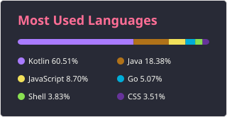

<h1 align="center">Hi, I'm Santiago Velix 👋</h1>

  Developer working on Android, mobile apps and tooling — Kotlin, Java, Go, Python and JavaScript.

## 🚀 Featured project

<table>
  <tr>
    <td>
      <a href="https://github.com/Kutjaneiro/Classic-galaxy-sounds"><b>🔊 Classic Galaxy Sounds</b></a> 
      Root module that brings the original sounds of classic Galaxy phones (Galaxy S3 and friends)
      to Samsung phones on One UI 8 / 9, plus a firmware extractor that pulls the sounds from the
      official firmware.  
      
      
      
    </td>
  </tr>
</table>

## 🛠️ Tech stack

  
  
  
  
  
  

## 📊 GitHub stats

  
  

